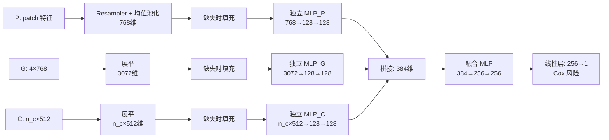

# 对照模型设置

本文记录 Table2/3 实际采用的模型结构、生存任务适配、缺失处理与训练配置。P、G、C 分别表示病理、基因、临床模态；所有模型均输出一个连续 Cox 风险分数，分数越高表示风险越高。

## 1. 比较组与输入表征

| 实验 | 实验组 | 对照组 | 控制条件 |
|---|---|---|---|
| Table2：推理期缺失 | MosaicSurv | Concat-zero、Concat-mean、MVAE、MoPoE、HGCN | 完整病例训练，一次训练评估七个非空输入子集 |
| Table3：训练期缺失 | MosaicSurv | Concat-mean、HGCN | 七种受控缺失设置，分别评估七个输入子集 |

因此，Table3 当前不包含 Concat-zero、MVAE 或 MoPoE。Concat-zero 与 Concat-mean 的网络结构相同，区别在缺失填充值。

常规模型使用冻结提取器产生的特征，各模型的下游可训练参数独立，不共享主模型 checkpoint。

| 模态 | 冻结表征 | 原始输入形状 | 进入 Concat / MVAE / MoPoE 的形式 |
|---|---|---|---|
| P | UNI-v1 | N_patch × 1024 | 经 WSI resampler 得到16个768维 token，再池化为768维向量 |
| G | scFoundation gene_raw | 4 × 768 | 展平为3072维向量 |
| C | 临床 prompt | n_c × 512 | 展平为 n_c×512 维向量 |

L0 的临床输入为4个 token，即2048维；L1 为10个 token，即5120维。L1 改变临床输入维度，后续隐藏维度与对应实验超参数保持不变。HGCN 使用另一套原生图表征，不使用上述 UNI/scFoundation/prompt 三份输入，详见第5节。

三类常规基线（Concat、MVAE、MoPoE）的 WSI resampler 与主模型采用相同结构：1024→768 输入投影、16个可学习 query、2个 cross-attention block、1个 self-attention block、8个注意力头、前馈隐藏维1024。超过4096个 patch 的 bag 按等间距索引选取4096个进入该前端；原始特征文件不改变。

Concat 对16个 token 直接平均；MVAE/MoPoE 对 token 平均后另加768→768的线性目标池化层。因此三者并非完全相同的 WSI 聚合器，独立训练也不代表加载主模型权重。

## 2. Concat-zero / Concat-mean：三路编码后的表征融合

### 2.1 网络结构与拼接位置

三个模态分别进入三个不共享参数的 MLP，得到三个128维表示，然后拼接为384维，经过融合 MLP 和线性风险头：

每个模态 MLP 为：Linear(D_m,128) → LayerNorm → ReLU → Dropout(0.25) → Linear(128,128) → ReLU。

融合 MLP 为：Linear(384,256) → ReLU → Dropout(0.25) → Linear(256,256) → ReLU → Dropout(0.25)，再由 Linear(256,1) 输出风险。

该结构属于模态级表征融合：先独立编码，再拼接并联合预测。它既不是原始三模态直接拼接后只进入一个 MLP，也不是三个独立风险分数的预测级平均。

### 2.2 缺失填充的对象与位置

- Concat-zero：缺失模态在对应模态 MLP 之前替换为全零向量。P 的填充对象是池化后的768维向量，G/C 是各自展平向量。
- Concat-mean：在每一折训练开始前，用该折训练集中对应模态可用的患者计算同一表示空间中的均值；均值随后固定，验证和测试不重新估计。
- 两种填充均发生在非线性模态编码之前，不是在三个128维输出上补值。
- 零输入经过带偏置的线性层、归一化和非线性后，隐藏表示可以非零；不能把 Concat-zero 描述为“缺失模态的128维表示恒为零”。
- 不额外拼接可用性指示位、模式 embedding 或模态 ID。可用性掩码只控制填充；融合 MLP 从拼接表示预测风险。

### 2.3 训练目标

只优化 Cox 部分似然损失，不增加重建、KL、Jeffreys、对比学习或跨模态一致性损失。zero/mean 对照用于检验填充策略的影响，二者不学习生成式联合后验。

## 3. MVAE：标准 PoE 与子集 ELBO

### 3.1 编码、融合与解码

P/G/C 经上述定长化后，各自进入一个独立高斯编码器：D_m→512→512，经 ReLU 后分别用两个512→128线性层输出均值和对数方差。

可用模态的高斯后验与标准正态先验共同进行 Product-of-Experts 聚合，得到128维联合后验；没有主模型中可学习的模态 PoE 权重，也没有模态私有 latent。

三个模态各有独立解码器：128→512→D_m，隐藏层用 ReLU，末端为 Sigmoid。重建目标分别为池化后的768维 WSI 表征、3072维 Gene 表征及 n_c×512维 Clinic 表征，不是原始病理图像或全部 patch。

生存适配为联合 latent 上的独立 Cox 头：128→256→1，隐藏层为 ReLU 与 Dropout(0.25)。训练时对联合后验重参数化采样，推理时取联合后验均值。该生存头没有 FiLM 条件化，也不为七个输入子集分别设置生存头。

### 3.2 目标与缺失处理

总目标为子集负 ELBO 之和加 Cox 损失，生存权重为1。三模态训练时的生成式子集包括：完整三模态、三个单模态，以及每次随机抽取的两个双模态子集；生存损失由联合 latent 计算，不等同于主模型对七子集逐个计算生存损失。

KL 目标权重为1，使用10轮 warmup；重建使用默认正态似然，不启用额外的跨模态似然重缩放。512维编码/解码隐藏层为 MultiVae 实际默认结构，不随主模型128维读出隐藏层一起改变。

缺失掩码使对应模态不贡献有效后验精度，也不计入该模态的重建损失；没有任何可用输入的生成式子集不参与该样本的子集目标。输入中的零占位仅用于张量接口，不表示把缺失模态当作真实零观测。

## 4. MoPoE：子集 PoE 后验的混合

MoPoE 与 MVAE 共享同样的定长前端、三个独立512维 MLP 编码器、128维共享 latent、三个解码器及128→256→1 Cox 头，但分别训练自己的参数。

其融合机制先对每个非空模态子集计算 PoE 后验，再混合可用子集的后验分量。三模态齐全时最多有七个非空分量；存在缺失时，仅由该患者真正可用的子集参与混合，可用分量采用均匀权重。当前原生实现仅在完整三模态 PoE 中加入标准正态先验，不能直接照搬 MVAE“每个子集均加先验”的描述。

生成式目标为观测模态重建项与加权子集 KL 正则，再加权重为1的 Cox 损失；KL 权重固定为1，没有 MVAE 的10轮 KL warmup，不启用模态私有 latent。

当前适配总是向 MoPoE 提供可用性掩码，原生混合推断会随机选择一个有效子集分量。训练时从所选分量采样 latent；评估时生存头取所选分量均值，但分量选择本身仍可能随机。因此不能把当前 MoPoE 评估描述为“直接使用所有分量的平均后验且完全确定”。

MVAE 与 MoPoE 保留的是生成式聚合及原生目标，特征前端和 Cox 生存头为本实验的任务适配，并非原论文已包含的生存预测网络。

## 5. HGCN：原生模态图、掩码重建与多分支风险

### 5.1 输入与图构造

| 模态 | 节点表征 | 连边 |
|---|---|---|
| P | 原始切片提取的 KimiaNet patch 特征 | 同一切片 patch 网格的8邻域 |
| G | 由 RNA 表达形成的 GSEA 基因家族/通路节点 | 无自环的有向全连接 |
| C | 原生临床编码产生的变量节点 | 沿用临床图资产的边；空边资产采用全连接 |

三个模态节点数由各自图资产决定，输入宽度由实际特征推断，不固定套用 UNI/scFoundation/prompt 的1024/768/512维组合。原生临床 L0/L1 与 prompt token 表不是同一种表示，不能把 n_c=4/10直接套到 HGCN 节点数。

### 5.2 网络与输出

三路分别通过独立 SAGEConv 映射至512维，随后为 ReLU、LayerNorm、Dropout(0.3)。每路通过512→128→1的注意力门控池化，得到模态级 token。

三个模态槽位进入 MAE：encoder/decoder深度各1、宽度512，再进行 Mixer 交互。重建 token 残差加回对应可用模态的节点表征，再做第二次独立注意力池化与归一化。

每个可用模态输出一个风险：512→128，经 ReLU、LayerNorm、Dropout(0.5) 后映射至1维。最终风险为可用分支风险的算术平均，不是把三个512维向量拼接后送入单个融合 MLP。

当前代码中 RNA 与 Clinic 分支使用各自的512→128映射，但末端128→1映射共用 RNA 分支的参数；不能将当前生存头写成“三个完全独立的两层风险头”。这是现有实现事实，本说明不修改其训练结构。

### 5.3 目标与掩码语义

训练采用多分支 Cox 损失，P/G/C 权重分别为5/1/5；MAE 只对被遮盖的模态 token 计算均方重建误差，权重5。保留多分支监督、MAE 和 Mixer，不替换成其他基线的单 Cox 头。

Table2 的训练使用原生随机模态 token 掩码，验证使用完整模态槽位。推理期按指定输入子集只编码可用模态，缺失槽位供 MAE 重建，最终风险只聚合可用模态的分支；不生成缺失模态的原始节点图。

Table3 将共享患者掩码转换为 MAE 的 token 掩码，替代原生随机采样。当前训练前向仍对原始三路图进行编码，重建 token 与节点表征通过残差结合；因此共享掩码的采样相同，不等于与 Concat“移除整个模态后填充”的信息路径完全相同。此差异须在训练期缺失对比中披露。

## 6. 训练配置与模型选择

以下为当前 Table2/3 的默认实验配置；历史结果按其训练批次记录。

| 方法 | 优化器 | 学习率 | 权重衰减 | Batch size | 隐表示/读出隐藏维 | 训练预算 |
|---|---|---|---|---|---|---|
| MosaicSurv（参照） | RAdam | 0.001 | 0.0001 | 16 | 128 / 128 | 20轮 |
| Concat-zero / Concat-mean | RAdam | 0.0005 | 0.001 | 128 | 每模态128 / 融合256 | 20轮 |
| MVAE / MoPoE | RAdam | 0.0005 | 0.001 | 128 | latent 128 / Cox隐藏256 | 20轮 |
| HGCN | Adam | 0.0005 | 0.0005 | 32 | 图及MAE 512 / 风险隐藏128 | 20轮循环，首轮不更新参数 |

Concat、MVAE、MoPoE 的前端及生存适配层 dropout 为0.25；MVAE/MoPoE 的默认512维编码/解码 MLP 不因此额外插入 dropout。常规训练器采用3轮学习率 warmup 和余弦调度；HGCN 使用原生阶梯调整规则，每20轮学习率乘0.5，不使用前述余弦调度。

常规基线从允许窗口内按验证 C-index 选 checkpoint，当前默认起点为第0轮；主模型采用完整模态验证 C-index，HGCN 从 epoch>1 的轮次按验证集平均分支风险的 C-index 选点。统一缺失设置下，各方法的验证输入与掩码作用位置仍需按其机制区分。

随机种子默认1。历史 L0 Table2 的主模型在 BRCA/LIHC 使用2、其余队列使用1，五个基线为1；L1 生成配置默认1。不能将旧批次表格中的数值差异解释为严格同种子重复实验。

## 7. 训练缺失、测试条件与指标口径

Table2 使用完整病例训练：MosaicSurv 保留0.35模态 dropout；Concat/MVAE/MoPoE 不额外施加同一随机 dropout，MVAE 的子集 ELBO 也不是相同的数据增强；HGCN 保留原生 token 掩码。

Table3 三个方法共用同一折、同一患者的掩码，掩码种子为1，主模型不叠加模态 dropout。P/G/C 缺失概率依次为60/0/0、0/60/0、0/0/60、30/30/0、30/0/30、0/30/30、20/20/20（%）；各模态独立抽样，全缺时保留一个原有模态。基础验证/测试也使用共享掩码，七个指定推理子集另按完整病例构造；HGCN 的掩码路径区别见第5节。

两实验均在七个 TCGA 队列按患者进行五折评估，每个训练条件测试 P、C、G、PC、PG、CG、PCG，不为各测试子集单独训练模型。HGCN 按图资产覆盖与划分名单取交集，实际有效患者数应据保留名单报告。

主要指标为 C-index：同一队列、同一输入条件报告五折均值与标准差。六种缺失条件用于鲁棒性比较，PCG 为完整参照；七子集平均值包含 PCG，不等于仅六种缺失条件的均值。跨队列汇总按队列等权，fold标准差不等于患者抽样置信区间。

既有内部划分中验证与测试集重合，需披露模型选择的限制。不同模态编码器、池化器、生成目标、头结构、优化器及掩码作用位置是本实验实际存在的差异，不能概括成“除融合方法外其余全部相同”。

完整实验矩阵见 [Table2](../Table2/Baselines_tests.md)、[Table3](../Table3/Table3_design.md)；原论文结构调研保留在 `model_structure/`。上述设置以当前实际模型与训练器为依据，不引入新的模型或实验组。
